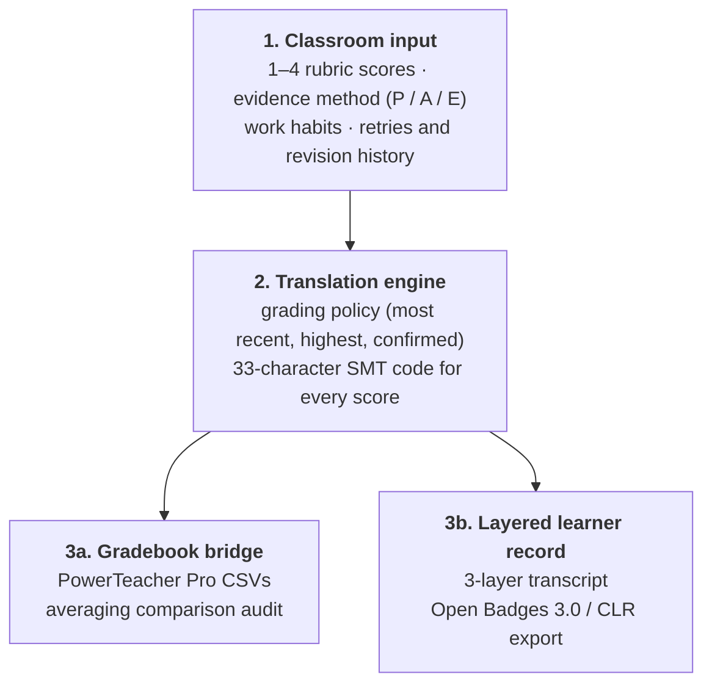

# SMT Mastery Dashboard

> **Grade what students can do now. Let the system catch up.**


The SMT Mastery Dashboard is a research prototype. Teachers grade on a **1–4 mastery scale**, and the dashboard turns those scores into **PowerSchool-ready grades** and a **layered learner record**. Teachers don't have to keep a second spreadsheet, and an early struggle doesn't permanently drag down a student's final grade.

It is the design artifact for a doctoral design-based research study on how competency-based grading can work inside legacy Student Information Systems (SIS).

**[▶ Try the live preview](https://YOUR-USERNAME.github.io/YOUR-REPO/)**

> [!WARNING]
> **Preview with fictional students. Do not enter real student information.**
> This is a pre-study prototype. Roster import, score import, and backup restore are turned off in this version.

---

## Contents

- [The problem](#the-problem)
- [How it works](#how-it-works)
- [Features](#features)
- [The 33-character SMT code](#the-33-character-smt-code)
- [How grades are calculated](#how-grades-are-calculated)
- [Giving feedback](#giving-feedback)
- [Running it yourself](#running-it-yourself)
- [Privacy and data](#privacy-and-data)
- [Roadmap](#roadmap)
- [Research context](#research-context)
- [Citation](#citation)
- [License](#license)

---

## The problem

Many teachers now organize instruction around mastery, reassessment, and flexible pacing. The systems that record grades were built for something else. Legacy SIS platforms such as PowerSchool are built around 0–100% point averages, seat-time credits, and A–F letters. That mismatch causes five recurring problems:

| Problem | What happens |
|---|---|
| **Averaging distortion** | A student who scores 1 in October and 4 in June is averaged down to a middling grade, even after reaching full proficiency. |
| **Double bookkeeping** | Teachers keep a shadow mastery spreadsheet alongside the official gradebook and translate scores by hand every marking period. |
| **Mixed signals** | Late penalties and participation points get blended into academic grades, so the grade no longer says what a student knows. |
| **Opaque transcripts** | A "B+" tells a college or employer nothing about which skills a student has mastered, or how they showed it. |
| **Structural limits** | The SIS has no place to store multiple attempts, rubric descriptors, or links to student work. |

This project builds a translation layer between the two systems: a bridge, not a replacement.

## How it works



The teacher scores once. The engine applies a published grading policy, encodes each score as a 33-character Standardized Mastery Taxonomy (SMT) string, and produces two outputs:
- a gradebook export the SIS can accept
- a richer learner record that links each grade back to its rubric and evidence

## Features

### For teachers

- **Fast scoring:** one-tap 1–4 mastery buttons with keyboard shortcuts, the evidence method beside each score (**P** live demonstration, **A** work sample, **E** exam), and one-tap retry flags.
- **Separate work habits:** habits of work are recorded beside the mastery grade instead of being mixed into it.
- **Evidence drawer:** a timeline of attempts for each student and standard, with links to artifacts and feedback. Corrections are logged, not overwritten.
- **Class views:** a students × standards heatmap, a retry queue, and multi-section schedule cards.
- **Small-group planning:** students at Level 1 and Level 2 are grouped by standard, with downloadable Markdown lesson briefs.
- **Student supports:** IEP, 504, and multilingual learner (ML) flags and accommodations, never diagnoses. ML records include status, English language proficiency (ELP) level, and supports.
- **Gradebook exports:** PowerTeacher Pro–ready CSVs and quarter bundles.

### For researchers and reviewers

- **Reviewer view:** hover anything to see how it works, and click to leave a comment.
- **SMT codebook:** a field-by-field breakdown of every code, a validator that flags codes not exactly 33 characters, and a downloadable codebook (.md/.csv).
- **Averaging comparison:** every audit compares the mastery grade with a named baseline ("same conversion table" or "raw-points average").
- **Reproducible exports:** every download records the app version, policy version, settings, and a SHA-256 fingerprint. "Check" rebuilds the file and confirms it matches.
- **De-identified research CSV:** pseudonymous IDs. Optional support flags, with groups under 10 suppressed.
- **Open Badges 3.0 / CLR preview:** a W3C Verifiable Credentials JSON-LD envelope. It is unsigned and labeled as a preview.

### Accessibility

Light and dark themes, a color-vision-deficiency mode, reduced motion, and full keyboard scoring. Layouts are tested at 360, 390, 414, and 768 px.

## The 33-character SMT code

Every score is encoded using the Standardized Mastery Taxonomy adapted from Uranis et al. (2019). The code has a 14-character **competency** half and an 18-character **assessment** half, joined by a hyphen.

```
PHY0101KNW0306-20261015P000123456

PHY  0101  KNW  03  06  -  20261015  P  000123456
│    │     │    │   │   │  │         │  └ District ID
│    │     │    │   │   │  │         └ Method
│    │     │    │   │   │  └ Date (YYYYMMDD)
│    │     │    │   │   └ Separator
│    │     │    │   └ Proficiency
│    │     │    └ Decay
│    │     └ Type
│    └ Competency ID
└ Domain
```

| Positions | Field | Length | Example |
|---|---|---|---|
| 1–3 | Domain | 3 | `PHY` |
| 4–7 | Competency ID | 4 | `0101` |
| 8–10 | Type | 3 | `KNW` |
| 11–12 | Decay | 2 | `03` |
| 13–14 | Proficiency | 2 | `06` (Level 3) |
| 15 | Separator | 1 | `-` |
| 16–23 | Date | 8 | `20261015` |
| 24 | Method | 1 | `P`, `A`, or `E` |
| 25–33 | District ID | 9 | NCES ID, zero-padded |

**Proficiency mapping:** Level 1→`02`, 2→`04`, 3→`06`, 4→`08`.

**District ID:** the default is the NCES district ID. The federally retired DUNS number is kept only as a labeled legacy option. A UEI is hashed to 9 characters so the code stays 33 characters long.

> The example above uses fictional values.

## How grades are calculated

The dashboard asks how the mastery grade and the averaged grade differ for a student who grows over the term. Take one student whose scores on a single standard go **1 → 2 → 3 → 4**:

| Method | Grade |
|---|---|
| **Mastery grade** (most recent evidence) | **A+ (97%)** |
| Averaged attempts (same conversion table) | B− (80%) |
| Plain points (level ÷ 4 × 100, averaged) | D (63%) |

The default conversion table is **1→50, 2→72, 3→87, 4→97**. It is marked *"Site decision: confirm with registrar."* A configurable pass rule, and a warning chip for any student at Level 1 with a passing letter, prevent a "Not yet" from quietly becoming a passing grade.

Grading rules available: **most recent**, **highest**, **average of recent attempts**, **decaying average**, and **most recent with a confirming attempt**. Every policy change creates a new policy version, so past exports can always be reproduced.

## Giving feedback

If you've been invited to review the preview:

1. Open the **[live preview](https://YOUR-USERNAME.github.io/YOUR-REPO/)** and choose a subject on the welcome screen.
2. Work through **Try this** in the demo bar. It has 10 short tasks and takes about 10–15 minutes.
3. Turn on **Reviewer view** (or press **R**) to hover for explanations and click to leave comments.
4. Open **Give feedback** and answer the "which fits your school?" questions.
5. Select **Copy everything and open the form**, paste into the form, and submit.

The form asks for no names. Feedback in this round is used only to improve the prototype before the formal study.

## Running it yourself

The whole app is one self-contained `index.html` file, with no build step and no dependencies to install.

```bash
git clone https://github.com/YOUR-USERNAME/YOUR-REPO.git
cd YOUR-REPO
# Open directly…
open index.html            # macOS
start index.html           # Windows
# …or serve locally
python3 -m http.server 8000   # then visit http://localhost:8000
```

**Deploying to GitHub Pages:** in **Settings → Pages**, set the source to the `main` branch, root folder. The site publishes at `https://YOUR-USERNAME.github.io/YOUR-REPO/`.

## Privacy and data

- **Fictional data only.** The demo students are generated, and real-data import is turned off in the preview.
- **Nothing leaves your browser.** Scores, comments, and the usage log are kept in your browser's local storage. The app has no server, no accounts, and no analytics.
- **Per browser.** Data saved in one browser or on one device doesn't appear on another. **Reset demo** clears it at any time.
- **Public link.** GitHub Pages URLs are public. The page is marked `noindex`, but treat the link as shareable.
- **Before any real use:** the pilot version (v0.48) will require IRB approval, district data-privacy review under Connecticut's student data privacy law, registrar confirmation of the conversion table, and a real NCES ID.

## Roadmap

| Version | Focus | Status |
|---|---|---|
| v0.45 | Core scoring, policy engine, SMT encoder, exports, Reviewer view | Done |
| v0.46 | IEP/504 supports, custom courses, section cards | Done |
| **v0.47** | **Preview build:** integrity fixes, ML supports, mobile fixes, welcome screen, *Try this*, *Give feedback*, reproducible exports | **Current** |
| v0.48 | **Pilot build (after IRB approval):** setup wizard and roster import, gradebook score import (no double entry), registrar view, full policy locking, data migrations, consent-gated usage logging | Planned |

## Research context

This prototype supports a doctoral **design-based research** study on bridging competency-based grading and legacy SIS infrastructure in Connecticut public high schools.

- **Practical frame:** pragmatism. The tool is judged by whether it works in real classrooms and registrar offices.
- **Theoretical frame:** institutional theory and the "grammar of schooling" (Tyack & Tobin, 1994). The middleware is studied as a way to *decouple* the ceremonial A–F grade from the mastery evidence underneath it.
- **Taxonomy:** the Standardized Mastery Taxonomy (Uranis et al., 2019), adapted for K–12 and Connecticut mastery-based learning policy (C.G.S. §10-221a).
- **Credential standards:** 1EdTech Open Badges 3.0 and the Comprehensive Learner Record (CLR), with W3C Verifiable Credentials.
- **Standards in the demo:** NGSS Physical Sciences, CT CSTA Computer Science, Connecticut Mathematics, and ELA.

## Citation

If you reference this prototype, please cite:

```
Shantharaj, S. (2026). SMT Mastery Dashboard (Version 0.47) [Computer software].
https://github.com/YOUR-USERNAME/YOUR-REPO
```

## License

*Choose a license before sharing publicly.* MIT is a common choice for open research software. Leave this section as **All rights reserved** if you'd rather keep control until the study is complete.

---

<sub>Built as part of doctoral research in educational leadership. Questions or feedback: open an issue or use the in-app <b>Give feedback</b> button.</sub>
